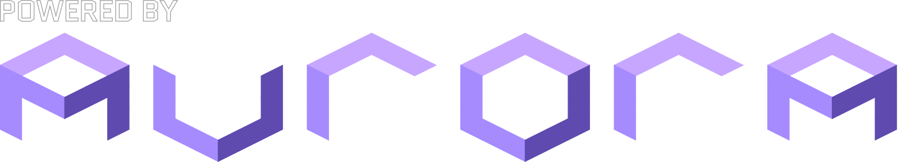

# Nookery

Nookery (formerly known as ACGC-PC-Port) is a native Windows/Linux/MacOS/Android port of Animal Crossing (GameCube), based on the
[ac-decomp](https://github.com/ACreTeam/ac-decomp) decompilation.

This repository contains no game assets. A legally obtained GAFE01 Rev 0 (USA)
disc image is required. RVZ, ISO, CISO and GCM images are supported.

## Running the port for players

- Download the latest release in the [Releases](https://github.com/flyngmt/ACGC-PC-Port/releases) page.
- Extract Nookery.
- Optionally download the [texture pack](https://forums.dolphin-emu.org/Thread-animal-crossing-hd-texture-pack-version-25-october-11th-2026)
(Highly recommended, it looks really good! Done by extremely talented artists) and put the extracted files under `/texture_pack`
- Run Nookery. You'll need to select your legally obtained Animal Crossing copy to play the game. 
Nookery includes various toggleable quality of life changes, we recommend taking a look under gameplay tab in settings. 
You might also want to take a peek at [features](#features) to have an idea about what to expect.

## Building and running for developers

See [BUILDING.md](BUILDING.md) for Windows, Linux, and macOS, and [BUILDING_ANDROID.md](BUILDING_ANDROID.md) for Android.
You can use `Nookery --help` to see available command line options after building.

## Data Folder

The data folder holds saves, `config.json`, `input.json`, `texture_pack/`,
and `nes_roms/`. Its default location is:

| Platform | Default data folder |
|---|---|
| Windows | The executable's folder |
| macOS | `~/Library/Application Support/Nookery/` |
| Linux | `~/.local/share/Nookery/` |
| Android | The app's internal files directory, exposed through its system documents provider |

Use Settings > Data to move game data to a custom folder.

## Save Data

Your main town is at `save/card_a/` in the data
folder. We support .GCI files, you can just use your dolphin save if you are migrating. You can put multiple towns in `save/card_b/` to visit them in game.

## Features

- Native 64-bit, Windows, Linux, macOS and Android support, with Vulkan, D3D12, D3D11 and Metal renderers via Aurora
- Widescreen support
- Unlocked framerate
- Borderless acres
- Dolphin HD texture pack support
- Full mouse support for walking, inventory and all of the overlays
- Keyboard support for typing letters
- Controller support with hotplug, button remapping and stick deadzones
- Touch controls on Android, with a layout editor and vibration
- Built-in NES emulator that allows loading your own ROMs from the `nes_roms` folder
- Multiple towns in Card B so you can select where you want to visit easily
- Ability to visit the island without a GBA
- Extended date support up to year 3000
- Quality-of-life options: fast text, single-player shop upgrades, optional Resetti, outdoor camera control, tool switch with D-pad and more!
- Custom UI
- Update checker for new releases

## Credits

This project would not be possible without the work of the [ACreTeam](https://github.com/ACreTeam) decompilation team. Thanks to everyone who worked on that project.

Even though Cuyler is already included in ACreTeam, his contributions go well beyond decompilation side. 
He gave me access to deluxe's code even though he had no reason to (the reason this port got so much QoL from deluxe mod!), 
and was always helpful whenever I had questions about how the game worked. It was a lot of fun working together,  
thanks man.

Also special thanks to the [Encounter](https://github.com/encounter) for handling so much of the Aurora migration, and their massive help, 
[Tom Lube](https://github.com/tomlube) for extensive private testing, [Aurora](https://github.com/encounter/aurora) developers,
[Dusklight](https://github.com/TwilitRealm/dusklight) team for both their help and advice,
and all [contributors](https://github.com/flyngmt/ACGC-PC-Port/graphs/contributors). This project couldn't get where it is without you.

Nookery icon and in game signs has been made by [Rainy Ram](https://bsky.app/profile/rainyr.am)
Old ACGC logo has been made by @YourPalFox.
Thanks to both of them, they are really talented and I would highly recommend checking them out.
And lastly, shoutout to Animal Crossing Modding Discord members for being such a chill community!

## AI Notice

This project had AI assistance during development (PC port code only).

## FAQ

See [FAQ](FAQ.md) for more info.

 

    

